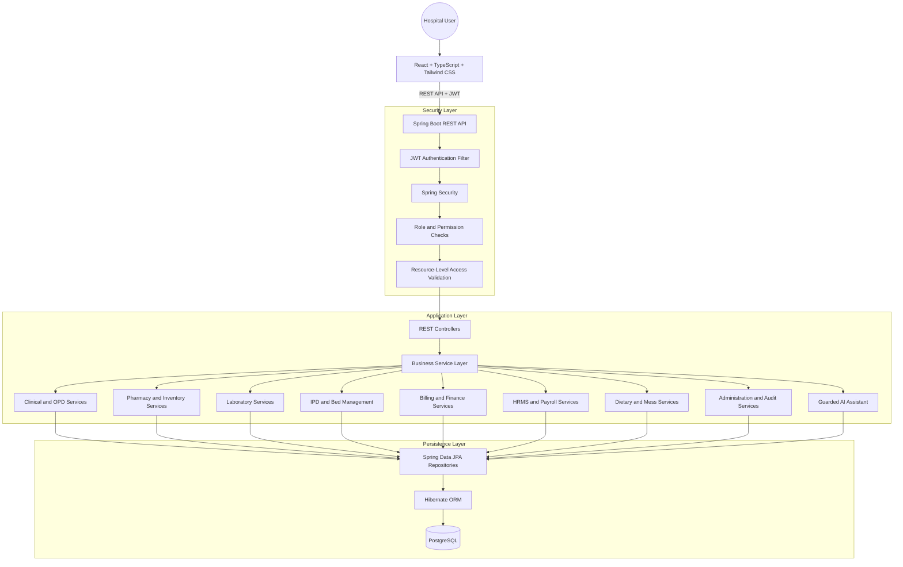
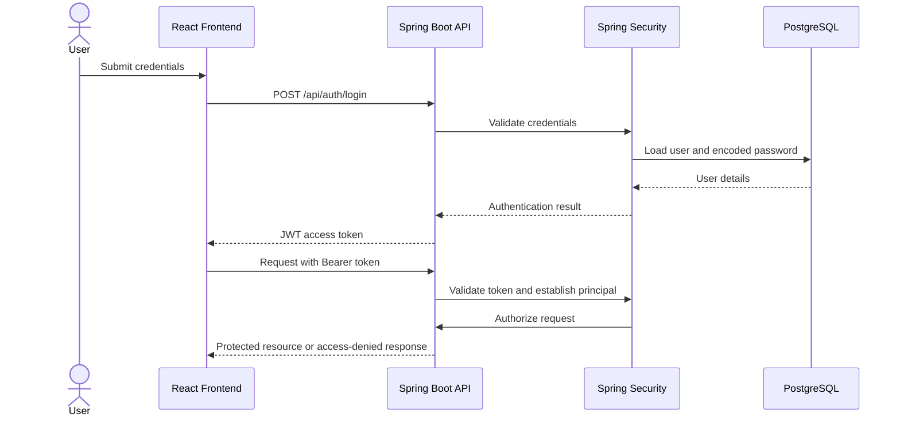
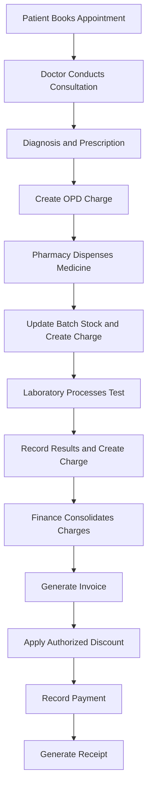

# 🏥 AegisCare — Hospital Management & Operations System

A full-stack, role-based **Hospital Management & Operations System** designed to streamline clinical workflows, hospital administration, pharmacy inventory, laboratory diagnostics, inpatient management, billing, finance, HRMS, and dietary operations.

Built with **React, TypeScript, Tailwind CSS, Java, Spring Boot, Spring Security, Spring Data JPA, Hibernate, and PostgreSQL**, AegisCare follows a modular backend architecture with centralized authentication, role-based authorization, transactional business workflows, and a guarded AI assistant layer.

---

## 🌟 Key Highlights & Engineering Features

- **Multi-Role Hospital Portal:** Dedicated dashboards for nine user roles — `ADMIN`, `DOCTOR`, `NURSE`, `PATIENT`, `PHARMACY`, `LAB`, `FINANCE`, `HRMS`, and `MESS`.
- **Secure Authentication & Authorization:** Spring Security-based authentication, JWT access-token validation, password hashing, and role-based endpoint protection.
- **Fine-Grained RBAC:** Role and permission checks enforced at the backend, with resource-level access restrictions for patient records, prescriptions, appointments, and financial information.
- **Layered Spring Boot Architecture:** Separation of controllers, services, repositories, entities, DTOs, security components, and exception handlers.
- **Transactional Pharmacy Management:** Database transactions for prescription dispensing, medicine stock updates, and associated billing charges.
- **Concurrent Bed Allocation:** Transactional inpatient admission workflows designed to prevent conflicting bed assignments using appropriate database constraints and concurrency controls.
- **Integrated Billing & Finance:** Consolidated departmental charges, invoice generation, authorized discounts, payment tracking, and receipt management.
- **Clinical & Diagnostic Workflows:** OPD appointments, consultations, ICD-10 diagnosis records, prescriptions, laboratory orders, specimen tracking, and diagnostic reports.
- **Hospital Staff Management:** Staff records, attendance, leave requests, roster management, and payroll-related records.
- **Privacy-Aware Departmental Access:** Restricts access to sensitive clinical data according to the user's role and assigned responsibilities.
- **Guarded AI Assistant & Admin Copilot:** Tool-based access to authorized hospital information, with an offline fallback mode and optional LLM integration.
- **Relational Database Design:** PostgreSQL-backed persistence using Spring Data JPA and Hibernate, with entity relationships, constraints, indexes, and transaction management.
- **Automated Testing:** Backend testing with JUnit 5, Mockito, and Spring Boot Test; API integration testing can use MockMvc or Testcontainers.

---

## 🏗️ System Architecture



### Architectural Design

AegisCare uses a **modular monolith** architecture. All hospital modules run within a single backend application but maintain separate business responsibilities.

- **Presentation Layer:** React components and role-specific dashboards.
- **API Layer:** Spring Boot REST controllers, request validation, DTOs, and HTTP responses.
- **Security Layer:** Spring Security filters, JWT authentication, role-based authorization, and resource ownership checks.
- **Service Layer:** Business rules, cross-module workflows, and transaction boundaries.
- **Persistence Layer:** Spring Data JPA repositories and Hibernate entity management.
- **Database Layer:** PostgreSQL tables, relationships, constraints, and indexes.
- **AI Integration Layer:** Authorized application tools that invoke existing services instead of exposing unrestricted database access.

This approach keeps deployment straightforward while allowing the codebase to evolve into separately deployed services if future requirements justify it.

---

## 🛡️ Role-Based Access Control (RBAC)

AegisCare uses backend-enforced role-based access control. The frontend controls which features are displayed, while Spring Security and application-level authorization determine whether an operation is permitted.

| Module | ADMIN | DOCTOR | NURSE | PATIENT | PHARMACY | LAB | FINANCE | HRMS | MESS |
|---|---|---|---|---|---|---|---|---|---|
| User Management | Full | — | — | — | — | — | — | — | — |
| Appointments | Full | Update | Read/Update | Own | — | — | Read | — | — |
| Patient Profiles | Full | Read/Update | Read | Own | Limited | Limited | Limited | — | Limited |
| Clinical Diagnosis | Full | Create/Update | Read | Own | — | — | — | — | — |
| Prescriptions | Full | Create/Update | Read | Own | Read | — | — | — | — |
| Medical Reports | Full | Create/Update | Limited | Own | — | Create/Update | — | — | — |
| Vitals & Nursing Notes | Full | Read | Create/Update | Own Vitals | — | — | — | — | — |
| Medication Administration | Full | Read | Create/Update | Own | Read | — | — | — | — |
| IPD & Bed Management | Full | Create/Update | Read/Update | Own | — | — | Read | — | — |
| Laboratory | Full | Create | Read | Own | — | Full | Charges | — | — |
| Pharmacy & Inventory | Full | — | Read | Own | Full | — | Charges | — | — |
| Supplies & Food Inventory | Full | — | — | — | Manage | Manage | Read | — | Manage |
| Diet Plans & Mess | Full | Create/Update | Read | Own | — | — | — | — | Fulfillment |
| Billing & Invoices | Full | Read | Limited | Own | Charges | Charges | Full | — | Charges |
| Discounts & Payments | Full | — | — | Own Payments | — | — | Full | — | — |
| HRMS & Attendance | Full | Own | Own | — | Own | Own | Own | Full | Own |
| Payroll | Full | — | — | — | — | — | Read | Full | — |
| Audit Logs | Full | — | — | — | — | — | — | — | — |
| AI Assistant / Copilot | Full | — | — | Own Data | — | — | — | — | — |

**Access-control principles:**

1. **Authentication:** Requests to protected APIs must be associated with a valid authenticated principal.
2. **Role authorization:** Endpoints and operations require the appropriate role or permission.
3. **Resource ownership:** Patients can access only their own records; ownership is verified by the backend.
4. **Departmental isolation:** Users access only the information necessary for their assigned responsibilities.
5. **Defense in depth:** UI restrictions never replace backend authorization.
6. **Least privilege:** Users receive only the access necessary for their responsibilities.

The matrix describes the intended access policy. Exact implementation should be reflected in endpoint security rules, service-level checks, and integration tests.

---

## 🔐 Authentication & Security

The backend is designed around Spring Security and token-based authentication.

### Authentication Flow



### Security Components

- **Spring Security:** Authentication and endpoint authorization.
- **JWT:** Stateless request authentication through a bearer token.
- **PasswordEncoder:** Secure password hashing using an appropriate adaptive password-hashing algorithm, such as BCrypt.
- **Method-Level Security:** Optional `@PreAuthorize` rules for fine-grained authorization.
- **Bean Validation:** Request validation using annotations such as `@Valid`, `@NotBlank`, and `@Email`.
- **Centralized Exception Handling:** Consistent API error responses through `@ControllerAdvice`.
- **Audit Logging:** Tracking of sensitive administrative and operational actions.
- **Secure HTTP Configuration:** Appropriate CORS policies, security headers, and environment-based secrets.

JWT validation alone is not sufficient for resource authorization. Patient ownership and departmental access must also be enforced in application logic.

---

## 🏥 Core Hospital Modules

### 1. Administration & User Management
- Role and account management.
- Department-level access policies.
- Hospital-wide operational dashboards.
- Audit trails and executive KPIs.

### 2. OPD & Clinical Management
- Appointment scheduling and OPD queues.
- Consultation notes and symptom recording.
- ICD-10 diagnosis records.
- Prescription creation and diagnostic test orders.
- Patient medical history and electronic health records.

### 3. Nursing & Inpatient Management
- Ward and bed management.
- Vitals recording and nursing notes.
- Medication administration records.
- Admission, transfer, and discharge workflows.
- Bed assignment and availability tracking.

### 4. Pharmacy & Inventory
- Medicine catalogue and batch-level stock management.
- Prescription dispensing workflows.
- Stock decrement and dispensing validation.
- Low-stock monitoring and inventory tracking.
- Automatic generation of associated billing charges.

### 5. Laboratory & Diagnostics
- Diagnostic order queues.
- Specimen collection and tracking.
- Test result entry and report generation.
- Authorized access to patient diagnostic records.
- Laboratory charge integration with finance.

### 6. Billing & Finance
- Departmental charge management.
- Invoice generation and charge consolidation.
- Authorized discount management.
- Payment records for UPI, card, and cash.
- Receipt generation and financial reporting.

### 7. HRMS & Payroll
- Staff profiles and department assignments.
- Attendance and leave management.
- Roster management.
- Payroll-related records and reporting.

### 8. Dietary & Mess Management
- Patient diet plans and meal schedules.
- Ward and bed-based meal delivery lists.
- Meal fulfillment tracking.
- Privacy-aware views that exclude unnecessary clinical details.

### 9. AI Assistant & Admin Copilot
- Patient-facing access to authorized personal information.
- Administrative summaries and operational insights.
- Low-stock alerts and departmental revenue summaries.
- Restricted, predefined tool execution rather than unrestricted database access.
- Deterministic fallback responses when an external LLM provider is not configured.

---

## ⚡ Clinical-to-Financial Workflow



### Transactional Integrity

Critical business operations should execute within appropriate Spring-managed database transactions.

**Pharmacy dispensing**

- Validate the prescription and medicine batch.
- Confirm sufficient available stock.
- Decrement inventory.
- Record dispensing.
- Create the corresponding financial charge.
- Commit the changes together or roll them back on failure.

**Inpatient bed allocation**

- Check bed availability.
- Apply appropriate locking or concurrency controls.
- Enforce database constraints against conflicting assignments.
- Persist the admission and bed allocation consistently.

**Billing and settlement**

- Aggregate eligible departmental charges.
- Preserve original charges when recording authorized discounts.
- Maintain invoice and payment records.
- Prevent invalid duplicate settlements through suitable constraints and idempotency controls.

These guarantees depend on the actual transaction boundaries, isolation settings, database constraints, and locking strategy implemented in the backend.

---

## 🤖 Guarded AI Assistant & Admin Copilot

The AI integration is designed to use application-controlled tools rather than granting a language model unrestricted database access.

### Example Authorized Tools

| Tool | Purpose |
|---|---|
| `getMyAppointments` | Retrieve appointments belonging to the authenticated patient |
| `getMyPrescriptions` | Retrieve prescriptions the authenticated patient is authorized to view |
| `getExecutiveOverview` | Retrieve authorized administrative KPIs |
| `getLowStockAlerts` | Retrieve inventory alerts available to the caller |
| `getRevenueByDepartment` | Retrieve permitted departmental financial summaries |

### AI Security Design

1. Authenticate the requesting user.
2. Verify role and resource-level permissions.
3. Validate the requested tool and its input.
4. Execute the corresponding application service.
5. Return only the authorized result.
6. Record sensitive operations in the audit trail where appropriate.

The model should not receive raw database credentials or unrestricted SQL execution capabilities.

An offline fallback can provide deterministic, predefined responses when external AI credentials are unavailable. Actual natural-language reasoning and tool calling require an implemented LLM integration; the fallback should not be presented as equivalent to a live LLM.

---

## 🗄️ Database & Persistence Design

**Database:** PostgreSQL  
**ORM:** Hibernate  
**Persistence API:** Spring Data JPA

The relational data model is designed to represent hospital operations through entities, relationships, constraints, and indexes.

### Representative Domain Entities

- `User`, `Role`, `Permission`
- `Patient`, `Doctor`, `Department`
- `Appointment`, `Consultation`, `Diagnosis`
- `Prescription`, `PrescriptionItem`, `MedicineBatch`
- `LabOrder`, `LabResult`, `MedicalReport`
- `Ward`, `Bed`, `Admission`
- `Vital`, `NursingNote`, `MedicationAdministration`
- `Charge`, `Invoice`, `InvoiceItem`, `Payment`, `Receipt`
- `Staff`, `Attendance`, `LeaveRequest`, `PayrollRecord`
- `DietPlan`, `MealSchedule`, `MealFulfillment`
- `AuditLog`

The final schema should reflect the entities and relationships actually implemented in the project.

### Persistence Features

- Entity mapping with JPA annotations.
- Foreign keys and referential integrity.
- One-to-one, one-to-many, and many-to-one relationships where appropriate.
- Repository abstractions through `JpaRepository`.
- Transaction management using `@Transactional`.
- Database indexes for frequently queried records.
- Optimistic or pessimistic locking for concurrency-sensitive workflows.
- DTO-based API contracts to avoid exposing persistence entities directly.

---

## 🛠️ Technology Stack

### Frontend

- **React 18** — Component-based UI.
- **TypeScript** — Static typing.
- **Vite** — Development server and production build tooling.
- **Tailwind CSS** — Responsive styling.
- **React Router DOM** — Client-side routing.
- **Lucide React** — Icons.
- **Recharts** — Dashboard visualizations.
- **Axios** — REST API communication and request interceptors.

### Backend

- **Java** — Primary backend language.
- **Spring Boot** — Application framework and REST API development.
- **Spring Web** — HTTP endpoints and REST controllers.
- **Spring Security** — Authentication and authorization.
- **Spring Data JPA** — Repository abstraction and persistence operations.
- **Hibernate ORM** — Object-relational mapping.
- **Bean Validation** — Input validation.
- **JWT** — Bearer-token authentication.
- **Maven** — Dependency management and build automation.

### Database

- **PostgreSQL** — Relational database.
- **SQL** — Data querying and relational operations.
- **JPA Entity Relationships** — Structured domain persistence.
- **Database Constraints & Indexes** — Integrity and query optimization.

### AI Integration

- **OpenAI API / Google Gemini API** — Optional LLM integration.
- **Guarded Tool Execution** — Permission-checked access to application services.
- **Deterministic Fallback Engine** — Predefined offline responses when supported by the implementation.

### Testing & Development Tools

- **JUnit 5** — Unit testing.
- **Mockito** — Mocking dependencies.
- **Spring Boot Test** — Application testing.
- **MockMvc** — HTTP-layer testing.
- **Testcontainers** — Optional PostgreSQL integration testing.
- **Git & GitHub** — Version control and collaboration.
- **Postman** — REST API testing.

---

## 🚀 Getting Started

### Prerequisites

Install the following before starting:

- Java 17 or higher, depending on the Spring Boot version.
- Maven or the project's Maven Wrapper.
- PostgreSQL.
- Node.js and npm.
- Git.

### 1. Clone the Repository

```bash
git clone <YOUR_GITHUB_REPOSITORY_URL>
cd AegisCare
```

Replace the repository URL and directory name with your actual values.

### 2. Configure PostgreSQL

Create a database:

```sql
CREATE DATABASE aegiscare;
```

Configure your backend environment using the application's actual configuration keys. For example, with environment variables:

```properties
SPRING_DATASOURCE_URL=jdbc:postgresql://localhost:5432/aegiscare
SPRING_DATASOURCE_USERNAME=${DB_USERNAME}
SPRING_DATASOURCE_PASSWORD=${DB_PASSWORD}
```

For Spring Boot configuration, map these values to the corresponding `spring.datasource.*` properties. Do not commit real database credentials or API keys to version control.

### 3. Start the Spring Boot Backend

Navigate to the backend directory containing `pom.xml`:

```bash
cd server
```

Run the application using the Maven Wrapper, if included:

```bash
./mvnw spring-boot:run
```

On Windows:

```powershell
.\mvnw.cmd spring-boot:run
```

Alternatively, if Maven is installed:

```bash
mvn spring-boot:run
```

The default Spring Boot port is usually `8080`, unless configured otherwise.

**Database initialization:** Configure the actual project migration or schema initialization process before starting. For production, prefer versioned migrations with Flyway or Liquibase rather than relying on automatic schema creation.

### 4. Start the React Frontend

Open a separate terminal:

```bash
cd client
npm install
npm run dev
```

Vite commonly serves the frontend at:

```text
http://localhost:5173
```

Configure the frontend API base URL to match the backend address and port.

### 5. Run Backend Tests

From the backend directory:

```bash
./mvnw test
```

On Windows:

```powershell
.\mvnw.cmd test
```

Or, with Maven installed:

```bash
mvn test
```

### 6. Access the Application

Open the frontend URL shown by Vite. Sign in using accounts seeded by the application's development seed process, if one is implemented.

Demo credentials should be documented only after verifying that the corresponding accounts are created by the actual project setup.

---

## 📁 Suggested Backend Package Structure

```text
server/
├── src/
│   ├── main/
│   │   ├── java/
│   │   │   └── com/aegiscare/
│   │   │       ├── config/
│   │   │       ├── security/
│   │   │       ├── auth/
│   │   │       ├── user/
│   │   │       ├── patient/
│   │   │       ├── appointment/
│   │   │       ├── clinical/
│   │   │       ├── pharmacy/
│   │   │       ├── laboratory/
│   │   │       ├── ipd/
│   │   │       ├── finance/
│   │   │       ├── hrms/
│   │   │       ├── dietary/
│   │   │       ├── ai/
│   │   │       ├── audit/
│   │   │       └── common/
│   │   └── resources/
│   │       └── application.yml
│   └── test/
│       └── java/
└── pom.xml
```

Each business module can follow a consistent structure:

```text
module/
├── controller/
├── service/
├── repository/
├── entity/
├── dto/
├── mapper/
└── exception/
```

This is a suggested organization, not a claim that every listed package already exists.

---

## 🧪 Testing Strategy

The testing strategy should validate both business correctness and access-control boundaries.

- **Unit Tests:** Validate business rules in service classes using JUnit and Mockito.
- **Controller Tests:** Verify request validation, response codes, and API contracts.
- **Security Tests:** Verify authentication requirements, role restrictions, and unauthorized access handling.
- **Resource-Ownership Tests:** Ensure patients cannot access another patient's records by changing identifiers.
- **Transaction Tests:** Verify that failed pharmacy dispensing or billing operations do not leave partial updates.
- **Concurrency Tests:** Exercise competing bed-allocation and inventory-update requests.
- **Integration Tests:** Test persistence behavior against PostgreSQL, preferably using Testcontainers.
- **Regression Tests:** Protect critical clinical-to-financial workflows against unintended changes.

---

## 🎯 Comprehensive Interview Talking Points

### 1. Why Spring Boot?

Spring Boot simplifies Java backend development through auto-configuration, dependency injection, embedded servers, and integration with the Spring ecosystem. It allows the application to expose REST APIs while keeping business logic organized into maintainable layers.

### 2. Spring Data JPA vs Hibernate

JPA defines the standard persistence API and entity-mapping model. Hibernate is an ORM implementation of JPA, while Spring Data JPA reduces repository boilerplate by providing abstractions such as `JpaRepository`.

### 3. Why Spring Security?

Spring Security provides a framework for authentication, request authorization, and method-level security. AegisCare combines endpoint-level restrictions with application-level resource ownership checks.

### 4. Why JWT Authentication?

JWT bearer tokens allow the API to authenticate subsequent requests without requiring a traditional server-side HTTP session. Token expiration, signature validation, secure storage, and appropriate revocation or refresh strategies remain important security considerations.

### 5. Why `@Transactional`?

`@Transactional` defines a transaction boundary so related database updates can succeed or fail together. Pharmacy dispensing is a useful example because stock updates, dispensing records, and billing charges must remain consistent.

### 6. How Do You Prevent Double Booking?

Use appropriate database constraints, transactional checks, and locking strategies. A simple availability check without concurrency control can fail when two requests attempt to allocate the same bed simultaneously.

### 7. Why a Modular Monolith?

It offers clear domain boundaries without the deployment, networking, and operational complexity of microservices. Modules can be separated later if scaling or independent deployment requirements justify that decision.

### 8. How Is Sensitive Patient Data Protected?

Enforce authentication, role authorization, resource ownership, data minimization, and auditability at the backend. Hiding information in the frontend alone is not sufficient.

### 9. How Does the AI Layer Stay Restricted?

The AI layer should call predefined application tools that enforce the authenticated user's permissions. The model should not receive unrestricted database access or be trusted to make authorization decisions itself.

### 10. How Would You Test the System?

Combine service unit tests, API and security tests, PostgreSQL integration tests, and transaction/concurrency tests. Critical workflows should include negative tests for unauthorized access and partial-failure scenarios.

---

## 🔮 Future Enhancements

- Docker-based development and deployment.
- Flyway or Liquibase database migrations.
- Refresh-token management and session/device controls.
- Centralized observability with structured logging and metrics.
- Redis caching for suitable read-heavy workloads.
- Asynchronous notifications for appointments and laboratory results.
- Payment gateway integration.
- More comprehensive clinical audit trails.
- CI/CD pipelines with automated tests and security checks.
- Expanded AI tool integrations with explicit authorization and audit policies.

---

## ⚠️ Project Scope & Disclaimer

AegisCare is a software engineering project for demonstrating hospital workflows, backend architecture, security, and transactional data management. It is not a certified clinical system and should not be used to make real medical decisions without appropriate validation, privacy safeguards, clinical oversight, and regulatory compliance.

**Note:** The listed capabilities describe the intended architecture. Production readiness depends on the actual implementation, tests, deployment configuration, and security review.

---

## 👨‍💻 Author

**Ishan Singh**

B.Tech — Computer Science and Engineering (Information Security)

GitHub: [Add your GitHub profile URL]

---

*Built with Java, Spring Boot, Spring Security, Spring Data JPA, Hibernate, PostgreSQL, React, and TypeScript.*
